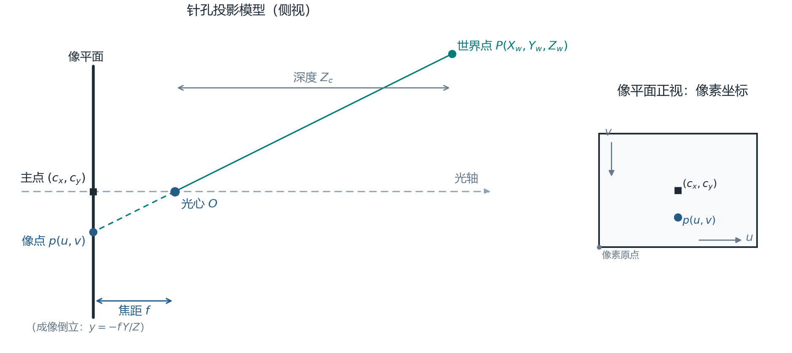

# 一、标定原理

## 1.1 针孔模型与内参

相机把三维世界点投影成像素，齐次坐标下写作

$$
w\begin{bmatrix}u\\v\\1\end{bmatrix}
=K\begin{bmatrix}R&t\end{bmatrix}
\begin{bmatrix}X_w\\Y_w\\Z_w\\1\end{bmatrix},
\qquad
K=\begin{bmatrix}f_x&\gamma&c_x\\0&f_y&c_y\\0&0&1\end{bmatrix},
$$

其中 $f_x,f_y$ 是焦距的像素当量、$c_x,c_y$ 是主点、$\gamma$ 是像素轴不垂直度。本文不传内参初值，
OpenCV 把 $\gamma$ 固定为 0，实际只解 $f_x,f_y,c_x,c_y$ 四个量；四组标定的 $|f_x-f_y|$ 相对差都在 1.4% 以内。

世界点 $P$ 与光心 $O$ 的连线交像平面于 $p$；像素 $u$ 向右、$v$ 向下，故同一侧的世界点落在主点"下方"。

| 符号 | 含义 |
|---|---|
| $[X_w,Y_w,Z_w]^T$ | 世界坐标，标定板面为 $Z_w=0$ |
| $[u,v]^T$、$[x,y]^T$ | 像素坐标与归一化坐标（$x=X_c/Z_c$，$y=Y_c/Z_c$） |
| $K$、$R,t$ | 内参矩阵、每张图的外参 |
| $s$ | 方格边长（板 1 为 50 mm，板 2 为 30 mm） |
| $r$ | 归一化半径，$r^2=x^2+y^2$ |

## 1.2 单应矩阵

令 $Z_w=0$，投影退化为平面单应

$$
w\begin{bmatrix}u\\v\\1\end{bmatrix}=H\begin{bmatrix}X_w\\Y_w\\1\end{bmatrix},
\qquad H=K\begin{bmatrix}r_1&r_2&t\end{bmatrix}.
$$

$H$ 有 8 个自由度，每对点给 2 个线性方程，4 对点即可解（DLT 后取 SVD 的最小奇异向量）。
本文每张图有 42 或 81 个角点，远超下限，单应的求解不是瓶颈。

## 1.3 从单应到内参：正交约束与闭式解

由 $H=K[r_1\ r_2\ t]$ 得 $h_1=\mu Kr_1$、$h_2=\mu Kr_2$。旋转矩阵的列正交且等长，于是每张图给出两个约束：

$$
h_1^TK^{-T}K^{-1}h_2=0,
\qquad
h_1^TK^{-T}K^{-1}h_1=h_2^TK^{-T}K^{-1}h_2 .
$$

记 $B=K^{-T}K^{-1}$（绝对二次曲线的像），把 6 个独立元素排成
$\mathbf{b}=[B_{11},B_{12},B_{22},B_{13},B_{23},B_{33}]^T$，则 $h_i^TBh_j=\mathbf{v}_{ij}^T\mathbf{b}$，其中

$$
\mathbf{v}_{ij}=
\begin{bmatrix}
h_{i1}h_{j1},\;
h_{i1}h_{j2}+h_{i2}h_{j1},\;
h_{i2}h_{j2},\;
h_{i3}h_{j1}+h_{i1}h_{j3},\;
h_{i3}h_{j2}+h_{i2}h_{j3},\;
h_{i3}h_{j3}
\end{bmatrix}^T .
$$

把每张图的两个约束堆成 $V\mathbf{b}=0$，$\mathbf{b}$ 取 $V$ 的最小奇异向量。$\mathbf{b}$ 只定到尺度、
实际 5 个独立约束，故至少 3 张不同姿态的图；得到 $B$ 后可解析反解内参（Zhang 附录 B）：

$$
\begin{aligned}
v_0&=\frac{B_{12}B_{13}-B_{11}B_{23}}{B_{11}B_{22}-B_{12}^2},\\
\lambda&=B_{33}-\frac{B_{13}^2+v_0\left(B_{12}B_{13}-B_{11}B_{23}\right)}{B_{11}},\\
f_x&=\sqrt{\frac{\lambda}{B_{11}}},\qquad
f_y=\sqrt{\frac{\lambda B_{11}}{B_{11}B_{22}-B_{12}^2}},\\
\gamma&=-\frac{B_{12}f_x^2f_y}{\lambda},\qquad
c_x=\frac{\gamma v_0}{f_y}-\frac{B_{13}f_x^2}{\lambda}.
\end{aligned}
$$

本文四组标定各用 3~4 张图，正好压在下限附近：$V$ 的条件数差时 $\mathbf{b}$ 对噪声极敏感，
这就是 3.1 节"删掉一张图后 $f_x$ 变化数百个百分点"的理论根源。

## 1.4 最大似然估计

代数解没有用到"残差最小"，只作为初值。设第 $i$ 张图第 $j$ 个角点检测值为 $m_{ij}$，最小化重投影误差

$$
\min_{K,\mathbf{k},\{R_i,t_i\}}\sum_{i=1}^{n}\sum_{j=1}^{m_i}\left\lVert m_{ij}-\hat m_{ij}\right\rVert_2^2 .
$$

OpenCV 用 LM 求解，本文配置为：无内参初值、最多 2000 次迭代、阈值 $10^{-10}$（见 `src/calibrate.py`）。
注意这里最小化的是训练集残差，参数越多越小，"RMS 小"不等于内参可靠——这一区分在 3.1 节用留一法检验。

| 概念 | 接口 | 脚本 |
|---|---|---|
| 投影与重投影 | `cv2.projectPoints` | `evaluate.py` |
| 单应/闭式解/联合优化 | `cv2.calibrateCamera` | `calibrate.py` |
| 去畸变 | `getOptimalNewCameraMatrix` + `initUndistortRectifyMap` + `remap` | `undistort.py`（见 3.2） |

## 1.5 畸变模型

实际镜头不满足"光线严格过光心"。OpenCV 在归一化平面上用五参数模型（径向 $k_1,k_2,k_3$，切向 $p_1,p_2$）：

$$
\begin{aligned}
x_d&=x\left(1+k_1r^2+k_2r^4+k_3r^6\right)+2p_1xy+p_2\left(r^2+2x^2\right),\\
y_d&=y\left(1+k_1r^2+k_2r^4+k_3r^6\right)+p_1\left(r^2+2y^2\right)+2p_2xy .
\end{aligned}
$$

径向项来自镜片曲率：放大率随半径变化，$k_1<0$ 画面向中心收缩（桶形）、$k_1>0$ 四角外拉（枕形）；
切向项来自镜片与传感器不平行（装配公差）。本文视图少、高阶径向项没有约束，B 的正式配置固定
$k_3=0$（`CALIB_FIX_K3`）、保留 $p_1,p_2$。实测系数见 `outputs/tables/distortion.csv`：板 1 的 camA 为
$k_1=0.0504$、camB 为 $k_1=0.160$，板 2 只有 $10^{-4}\sim10^{-3}$ 量级——但板 2 的 $f_x$ 本身不稳，
不能只凭"系数小"判定校正可靠（见 3.2）。

## 1.6 可辨识性

1.3 的"至少 3 张"只是方程数下限，不保证数值稳定：板面占比小、姿态单一时 $f_x$ 会与 $c_x$ 互相补偿。
本文每个相机组只有 3~4 张图，留一法下 left 的 $f_x$ 在 72~1560 px 之间跳跃（3.1.4），
camA 在四组 flags 之间也有约 4% 差异。因此第 3 章先看误差大小、再看参数稳定性，最后才讨论能否用于测量。

参考文献：Z. Zhang. A flexible new technique for camera calibration. *IEEE TPAMI*, 22(11):1330–1334, 2000.
OpenCV `calib3d` 文档：<https://docs.opencv.org/4.x/d9/d0c/group__calib3d.html>。
